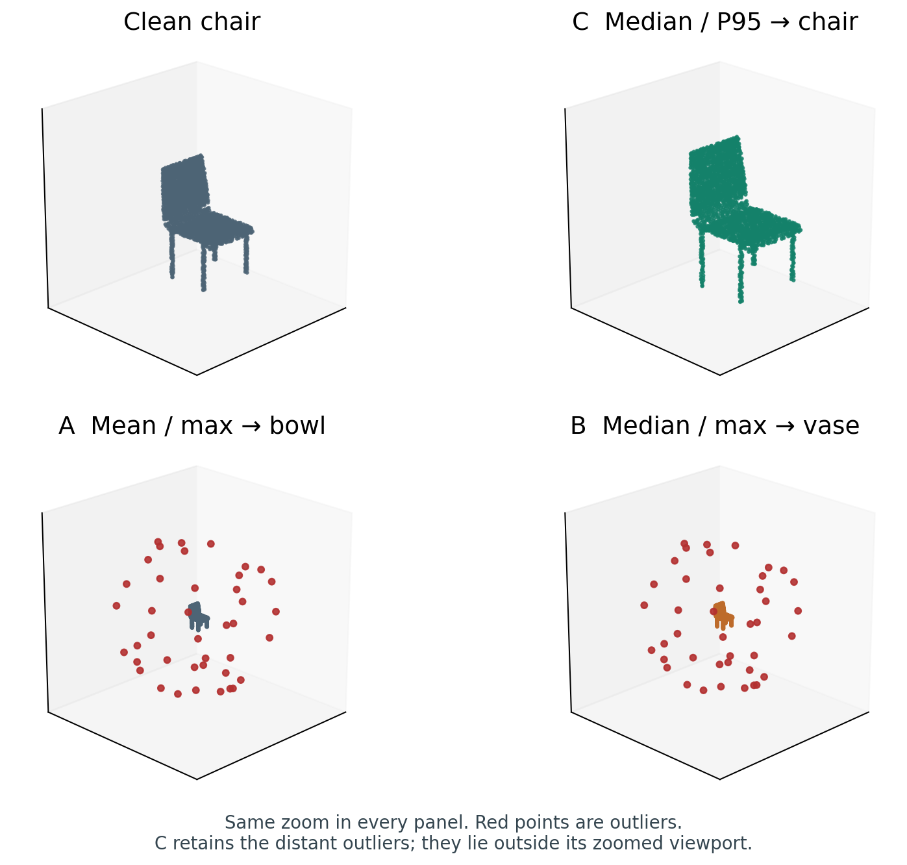
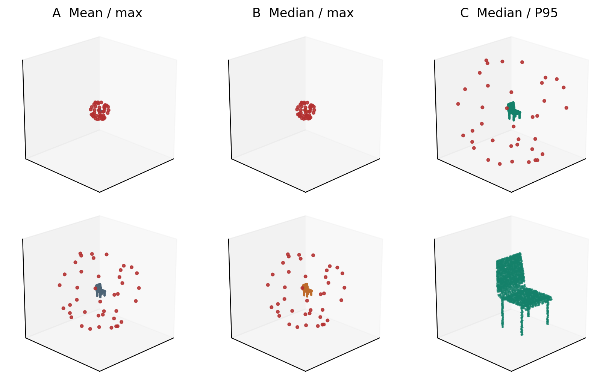
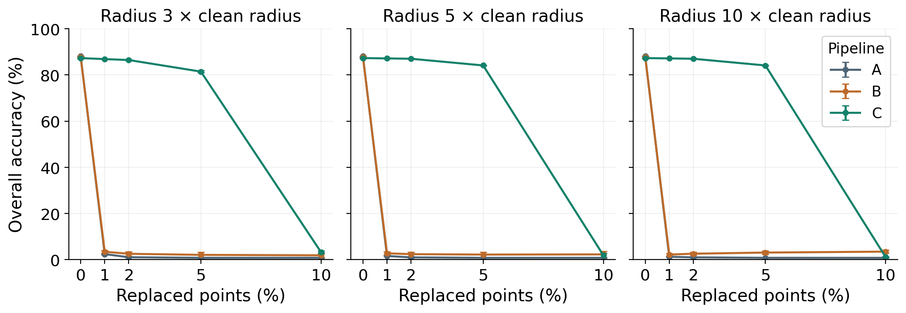
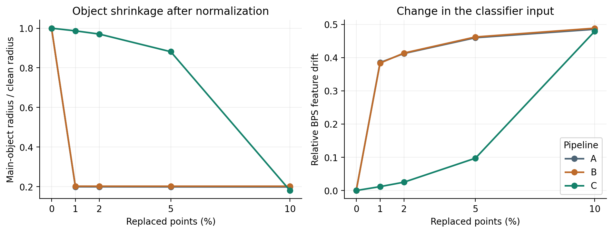

# BPS point cloud classification under distant outliers

A controlled study of how centring and scaling affect a **Basis Point Sets (BPS) + multilayer perceptron** classifier. Three pipelines use the same architecture, shared reference points and matched corruptions. The repository includes **nine pretrained models, per-object predictions, the experiment code and a chair demo**.

Author: **Somavarapu Dinesh Reddy** · E&ECE, IIT Kharagpur  
Source method: [Prokudin, Lassner and Romero, ICCV 2019](https://arxiv.org/abs/1908.09186).

## See the chair example



**Ground truth: chair.** Replace 41 of 2048 points (nominally 2%) with points at five times the clean radius. With training seed 13 and corruption seed 101:

| Input | A — mean / maximum | B — median / maximum | C — median / P95 |
| --- | --- | --- | --- |
| Clean chair | chair | chair | chair |
| Same corrupted chair | bowl | vase | **chair** |

The example is the **first chair in standard test-file order**, selected independently of its predictions: test index 3, `chair/chair_0978.ply`. [Sample provenance](examples/chair.json) · [Recorded predictions](results/demo.json).

Every panel uses the same zoom. **C does not remove outliers**; its distant points are outside this zoomed viewport.

<details>
<summary>Show the full extent and the zoomed views</summary>



The top row shows the full extent. The bottom row zooms to the main object. All points are retained during normalization and classification.

</details>

## Measured results

**Overall accuracy (%), mean ± sample SD across three training seeds.** For each nonzero condition, three corruption draws are averaged within each trained model first.

| Test condition | A — mean / max | B — median / max | C — median / P95 |
| --- | ---: | ---: | ---: |
| Clean | 88.07 ± 0.14 | 87.76 ± 0.21 | 87.28 ± 0.20 |
| 2% outliers, radius 5× | 1.01 ± 0.11 | 2.41 ± 0.92 | 86.98 ± 0.21 |
| 10% outliers, radius 5× | 0.81 ± 0.00 | 2.31 ± 1.37 | 1.92 ± 0.99 |



**Operating limit:** C retains near-clean accuracy under sparse distant outliers in this protocol, but fails at 10% contamination. Its clean accuracy is 0.80 percentage points below A. These results do not establish general sensor-noise, rotation or adversarial robustness.

<details>
<summary>Full outlier sweep with uncertainty</summary>

All accuracies below are percentages. Radius is relative to the uncorrupted cloud's maximum radius and is used only by the corruption generator.

| Outlier radius | Replaced points | A | B | C |
| --- | ---: | ---: | ---: | ---: |
| 3× | 1% | 2.42 ± 0.20 | 3.47 ± 0.52 | 86.84 ± 0.08 |
| 3× | 2% | 1.08 ± 0.04 | 2.57 ± 0.95 | 86.44 ± 0.22 |
| 3× | 5% | 0.81 ± 0.00 | 2.11 ± 1.15 | 81.42 ± 0.52 |
| 3× | 10% | 0.81 ± 0.00 | 1.91 ± 0.99 | 3.25 ± 0.59 |
| 5× | 1% | 1.62 ± 0.10 | 2.78 ± 0.64 | 87.14 ± 0.13 |
| 5× | 2% | 1.01 ± 0.11 | 2.41 ± 0.92 | 86.98 ± 0.21 |
| 5× | 5% | 0.81 ± 0.00 | 2.23 ± 1.12 | 84.10 ± 0.15 |
| 5× | 10% | 0.81 ± 0.00 | 2.31 ± 1.37 | 1.92 ± 0.99 |
| 10× | 1% | 1.27 ± 0.03 | 2.23 ± 0.56 | 87.14 ± 0.13 |
| 10× | 2% | 1.03 ± 0.17 | 2.61 ± 0.66 | 86.98 ± 0.21 |
| 10× | 5% | 0.82 ± 0.02 | 3.10 ± 0.84 | 84.09 ± 0.14 |
| 10× | 10% | 0.81 ± 0.00 | 3.50 ± 0.68 | 1.13 ± 0.32 |

</details>

[Raw metrics](results/metrics.csv) · [Aggregated table](results/aggregated_accuracy.csv) · [Per-object predictions](results/predictions) · [Audit](results/audit.json)

The evaluation uses **2468 test clouds**, **three training seeds**, **three corruption draws**, and **333 model-condition records**. Repeated predictions of the same object are not independent new test objects. The PointNet HDF5 conversion contains 9840 training clouds; 7872 are used for fitting and 1968 for validation. Checkpoints are chosen using validation data before final test evaluation.

## Clone and run the pretrained models

Use **Python 3.12**. The checkpoints and small chair example are included, so the demo runs after dependency installation.

```bash
git clone https://github.com/dinesh-reddys/bps-robust-normalization.git
cd bps-robust-normalization
python3.12 -m venv .venv
source .venv/bin/activate
python -m pip install --upgrade pip
```

On Windows, create the environment with `py -3.12 -m venv .venv`, then activate it with `.venv\Scripts\Activate.ps1` in PowerShell.

### CPU setup

Linux and Windows:

```bash
python -m pip install torch==2.9.1 --index-url https://download.pytorch.org/whl/cpu
python -m pip install -r requirements-inference.txt
python -m pip install -e . --no-deps
python scripts/demo.py
```

On macOS, use `python -m pip install torch==2.9.1` for the first command. The other commands are unchanged.

Expected corrupted-chair predictions: **A: bowl, B: vase, C: chair**. The default demo uses CPU inference.

### NVIDIA GPU setup

Use a CUDA-compatible driver. The original run used the CUDA 12.8 wheel:

```bash
python -m pip install torch==2.9.1 --index-url https://download.pytorch.org/whl/cu128
python -m pip install -r requirements-inference.txt
python -m pip install -e . --no-deps
python scripts/demo.py --device cuda
```

[Official PyTorch installation variants](https://pytorch.org/get-started/previous-versions/#v291).

### Pull later updates

From the cloned repository:

```bash
git pull --ff-only
```

### Use your own XYZ point cloud

Save a finite `N × 3` NumPy array as `.npy`, or a `.npz` archive with a `points` array:

```bash
python scripts/predict.py --input examples/chair.npy --pipeline C --device cpu
python scripts/predict.py --input my_object.npy --pipeline A --training-seed 37
```

Python API, after the editable install:

```python
import numpy as np
from btp.inference import BPSClassifier

model = BPSClassifier(pipeline="C", training_seed=13, device="cpu")
points = np.load("examples/chair.npy")
result = model.predict(points)
print(result["category"])  # chair
```

The saved classifiers were evaluated on canonically oriented CAD surface samples. Accuracy on arbitrary real scans or other orientations has not been established. BPS is invariant to point order, but is not generally rotation invariant.

## How the comparison works

```text
2048 XYZ points → normalization A/B/C → 512 BPS distances → MLP → 40 categories
```

| Pipeline | Centre | Scale |
| --- | --- | --- |
| A | Mean | Maximum radius |
| B | Coordinate-wise median | Maximum radius |
| C | Coordinate-wise median | 95th-percentile radius |

A distant outlier can increase a maximum-based scale estimate and shrink the main object relative to the fixed BPS basis. B changes centring only; C also changes scaling. All three classifiers are trained separately with their corresponding preprocessing.



The source authors already acknowledge normalization sensitivity. This repository contributes an implemented classification comparison and analysis of that issue; it does not claim a new general robust statistic or a universal outlier defence. Nearby outliers can also alter nearest-distance features directly.

## Reproduce the full experiment

Use a separate checkout for new runs: the tracked result files preserve the published run. Install the full study dependencies, download the standard data, and run:

```bash
python -m pip install -r requirements.txt
python scripts/download_data.py
python scripts/run_study.py prepare
python scripts/run_study.py train --retrain
python scripts/run_study.py evaluate --recompute
python scripts/analyze.py
python scripts/verify_study.py
```

`--retrain` fits the models again instead of reusing the included checkpoints. `--recompute` regenerates predictions. The downloader checks the public data against the recorded SHA-256 hashes. The full dataset is downloaded separately; the repository includes one attributed chair example.

Original hardware: **RTX 4050 Laptop GPU, 6 GB VRAM**. Total measured training time for the nine fits was **8.8 minutes**, excluding installation, downloads and feature preparation. Training falls back to CPU when CUDA is unavailable; timings on other machines will differ. [Environment](results/environment.json) · [Frozen configuration](config.json) · [Training summary](results/training_summary.csv).

Model selection, data splits, random seeds, hashes and numerical aggregation are recorded. `verify_study.py` recomputes metrics from saved predictions, checks data and checkpoint hashes, verifies mesh-identity separation, and compares spatial-tree distances with a brute-force calculation.

Run the tests after installing the full requirements:

```bash
PYTEST_DISABLE_PLUGIN_AUTOLOAD=1 python -m pytest -q tests
```

## Report, slides and source

- [12-page report PDF](deliverables/BTP1_Report.pdf)
- [Editable LaTeX project](report/main.tex) · [Download LaTeX source](deliverables/BTP1_LaTeX_Source.zip)
- [10-slide PowerPoint](deliverables/BTP1_Presentation.pptx)
- [Speaker script and timing](deliverables/Presentation_Timing.md): **540-second target**, **600-second talk limit**, **120-second Q&A separately**.
- [Model implementation](src/btp/model.py) · [Inference API](src/btp/inference.py) · [Training and evaluation](scripts/run_study.py)

Optional presentation rebuild with Node.js 20 or newer:

```bash
npm ci
npm run build:slides
```

The builder uses public npm dependencies and the included theme helper. For the report, regenerate numerical sections with `python scripts/build_report.py`, then compile `report/main.tex` with a LaTeX engine or use the provided Overleaf-ready source archive.

The report remains subject to student review and supervisor endorsement; signature spaces are blank.

## Attribution

- **BPS:** Prokudin, Lassner and Romero, *Efficient Learning on Point Clouds With Basis Point Sets*, ICCV 2019. [Paper](https://arxiv.org/abs/1908.09186) · [Author code](https://github.com/sergeyprokudin/bps).
- **Data:** Wu et al., *3D ShapeNets*, CVPR 2015; PointNet's 2048-point HDF5 conversion. [Data provenance and hashes](results/dataset_provenance.json) · [Chair provenance](examples/chair.json). Original dataset rights and terms remain applicable.
- **Related robustness work:** Ren, Pan and Liu, ICML 2022. [Paper](https://proceedings.mlr.press/v162/ren22c.html). Our spherical replacement protocol is a custom diagnostic, not the official PointCloud-C benchmark.
- [Full sources and implementation attribution](SOURCES.md). The included author reference code retains its MIT-0 licence. Implementation, execution, analysis and document drafting were assisted by Codex.
